# Кейсы для проверки

Тот же список доступен в приложении — выпадающий список над редактором.
Копируй блок целиком и вставляй в textarea.

## 1. Пример из задачи

_Проверяет: база: бокс, ромб, подписи рёбер, цикл D → B_

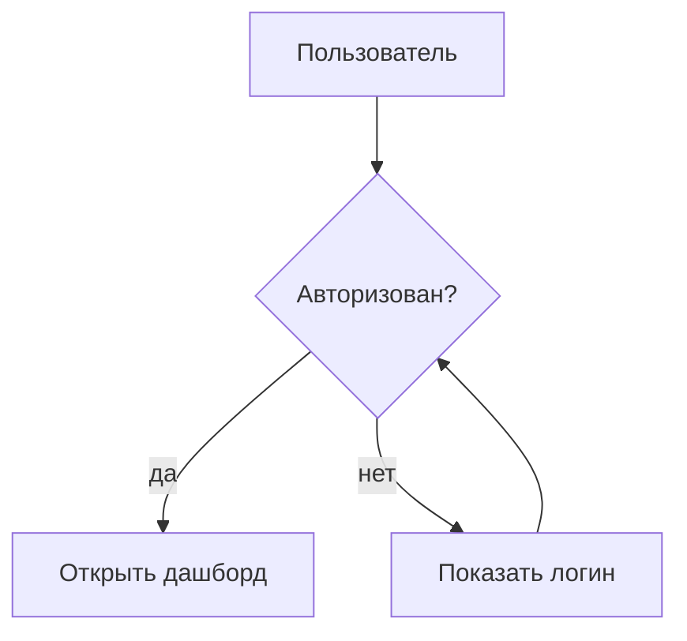

## 2. Линейный процесс

_Проверяет: простая цепочка, вертикальная раскладка_

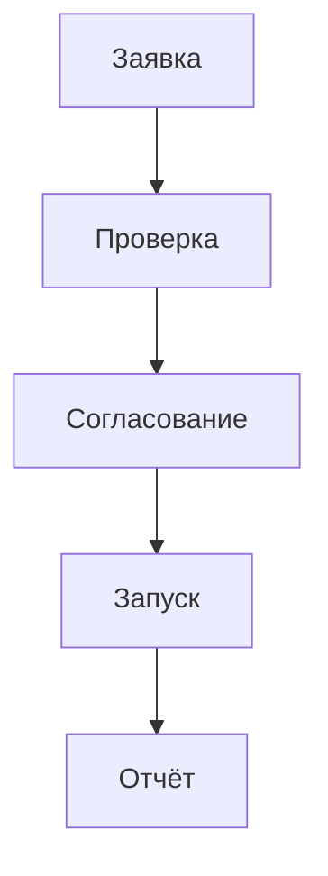

## 3. Все формы

_Проверяет: box, round, pill, circle, hexagon, decision_

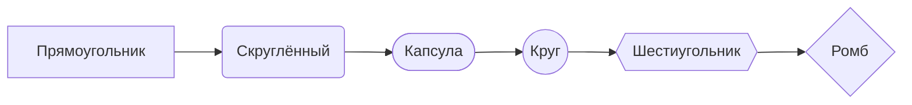

## 4. Все типы связей

_Проверяет: solid, dashed, thick, без стрелки, двусторонняя_

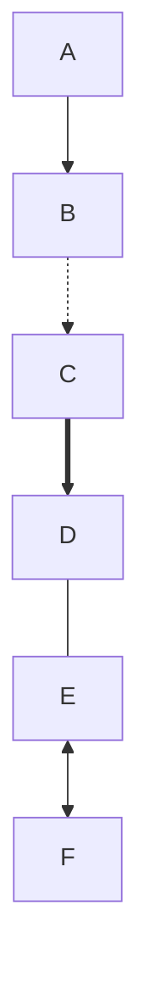

## 5. Подписи связей, два синтаксиса

_Проверяет: |текст| и -- текст -->_

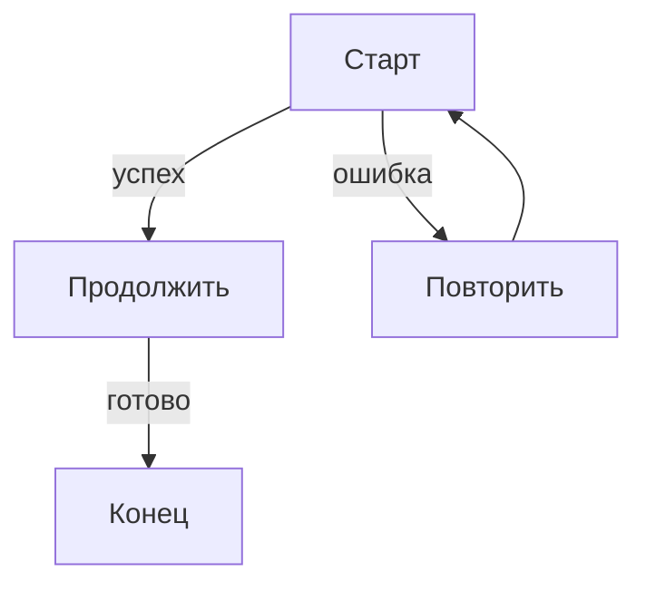

## 6. Горизонтальная схема (LR)

_Проверяет: направление слева направо_

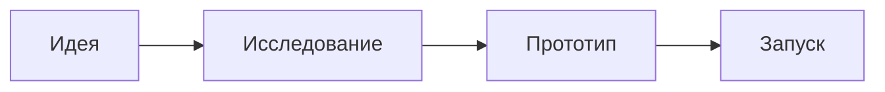

## 7. Снизу вверх (BT)

_Проверяет: обратное направление_

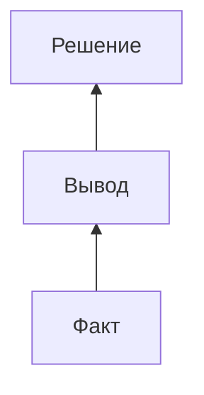

## 8. Текст: короткий (шрифт 18)

_Проверяет: базовый размер, минимальный бокс_

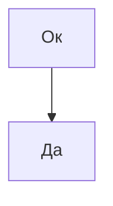

## 9. Текст: средний (перенос строк)

_Проверяет: обёртка в 3 строки, шрифт ещё базовый_

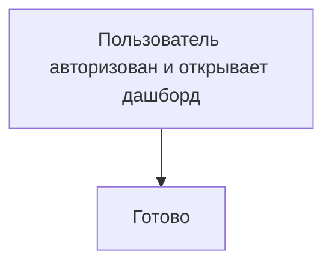

## 10. Текст: длинный (шрифт уменьшается)

_Проверяет: fit-text: бокс НЕ растёт, шрифт падает до ~13px_

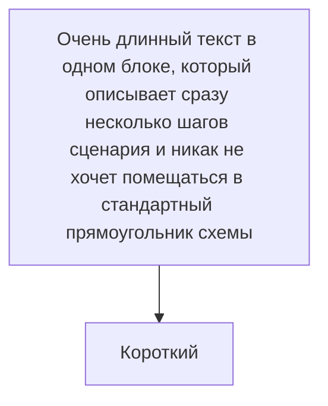

## 11. Текст: огромный (обрезка «…»)

_Проверяет: предел: шрифт 11px, многоточие, бокс не выходит за 260×132_

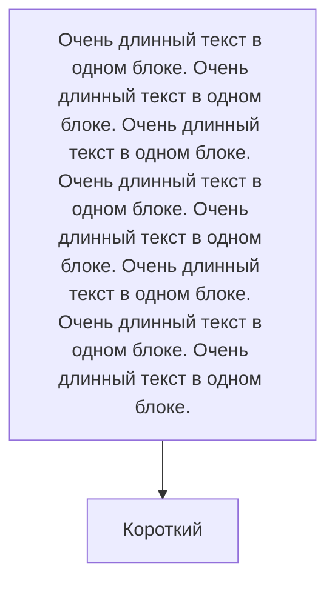

## 12. Текст: одно слово без пробелов

_Проверяет: жёсткий перенос по символам_

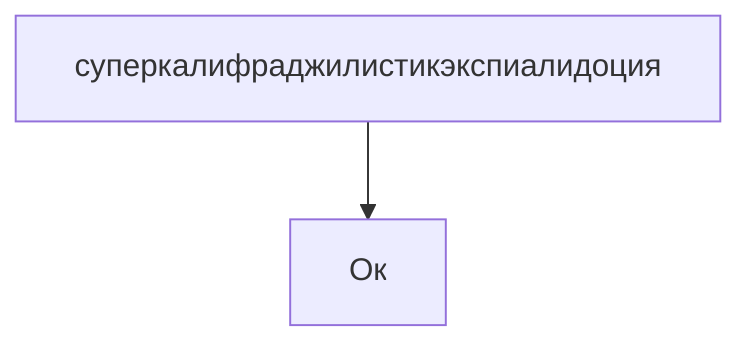

## 13. Markdown в подписях

_Проверяет: **жирный**, `код`, <br/> перенос_

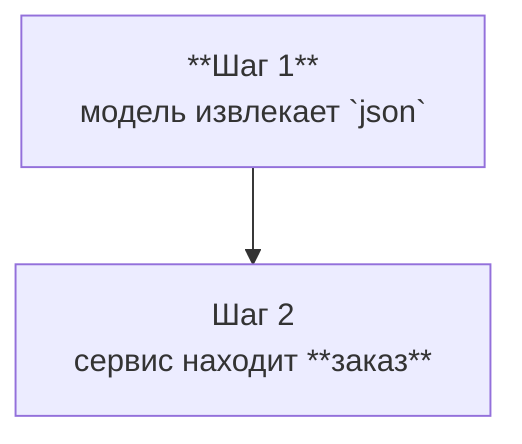

## 14. Акцентный и приглушённый узлы

_Проверяет: :::accent — брендовый градиент; :::muted — пунктирная рамка_

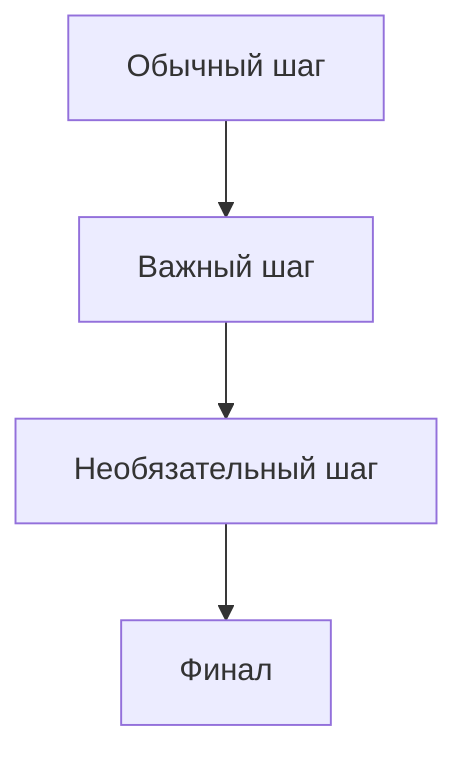

## 15. Пользовательские стили (игнорируются)

_Проверяет: classDef/style не применяются, показывается предупреждение_

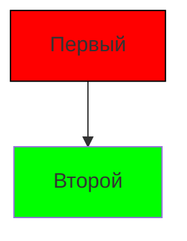

## 16. Группа (subgraph)

_Проверяет: группы рисуются пунктирными контейнерами (ELK-кластеры)_

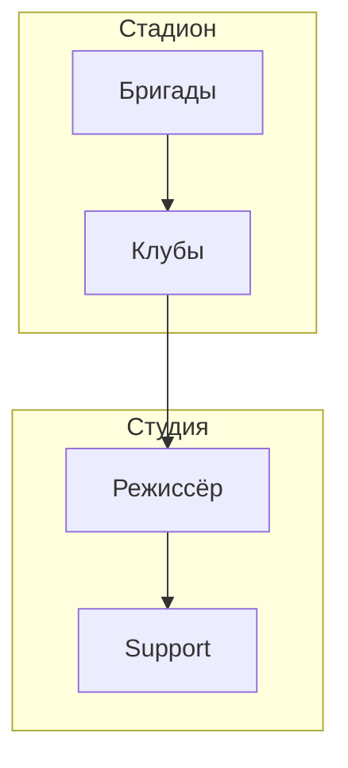

## 17. Много узлов (20)

_Проверяет: производительность и читаемость большой схемы_

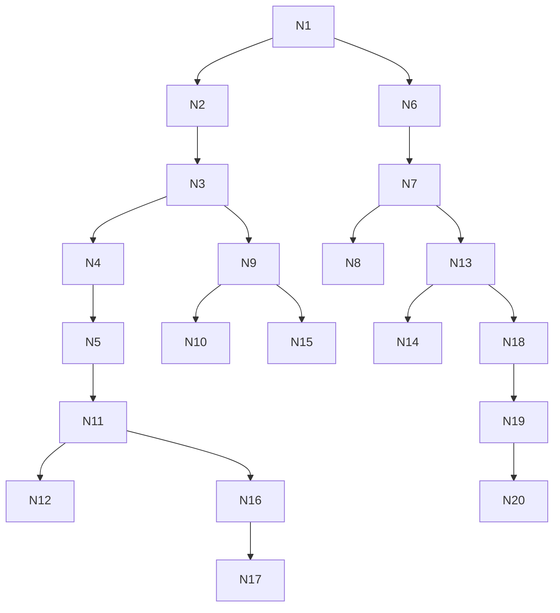

## 18. Веер: 1 → 6 и 6 → 1

_Проверяет: широкая раскладка, много параллельных линий_

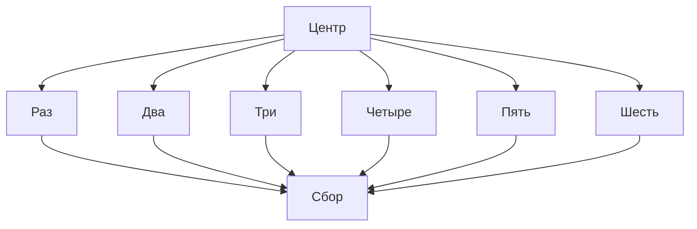

## 19. Несвязные компоненты

_Проверяет: два независимых графа на одном холсте_

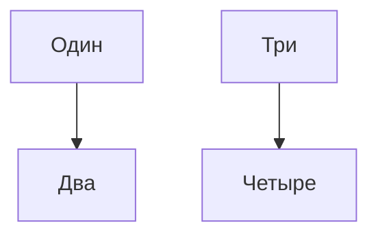

## 20. Петля на себя

_Проверяет: ребро A → A не должно ломать раскладку_

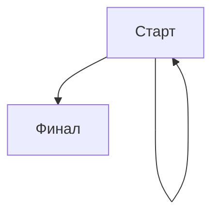

## 21. Ромб с длинным текстом

_Проверяет: текст вписан в 0.60×0.50 ромба, не вылезает за скосы_

```mermaid
flowchart TD
    A{Пользователь авторизован и имеет активную подписку?} --> B[Да]
    A --> C[Нет]
```

## 22. Бейджи-номера

_Проверяет: «1. текст» -> номер в кружке слева, без нового синтаксиса_

```mermaid
flowchart LR
    A[1. Понять проблему] --> B[2. Сформулировать задачу]
    B --> C[3. Задать критерии]
    C --> D[4. Принять решение]
```

## 23. Шеврон и вторичный акцент

_Проверяет: A>текст] -> шеврон; :::secondary -> синяя карточка_

```mermaid
flowchart TD
    A>Старт процесса] --> B[Обычный шаг]
    B --> C[Второй поток]:::secondary
    C --> D>Финиш]
```

## 24. Чипы через «+»

_Проверяет: связь без линии и без стрелки: рисуется только разделитель «+»_

```mermaid
flowchart LR
    A[Входные данные] ---|+| B[Ответ модели] ---|+| C[Время ответа] ---|+| D[Результат проверки]
```

## 25. Акцент обводкой + цветные контейнеры

_Проверяет: :::outline — белая карточка с зелёной рамкой; контейнеры чередуют зелёный и синий_

```mermaid
flowchart TD
    subgraph Стадион
      A[Бригады] --> B[Клубы]
    end
    subgraph Студия
      C[Режиссёр] --> D[Support]
    end
    B --> C
    C --> E[Директор по коммуникациям]:::outline
```

## 26. Разные блоки: БД, подпрограмма, ввод/вывод, трапеция, двойной круг

_Проверяет: полный набор фигур flowchart_

```mermaid
flowchart LR
  UI --> API --> DB[(Database)]
  API --> P[[Обработать данные]]
  P --> IO[/Входные данные/]
  IO --> M[/Ручная операция\]
  M --> C(((Процесс)))
```

## 27. База данных (цилиндр)

_Проверяет: [(...)] — цилиндр; LR-цепочка UI → API → DB_

```mermaid
flowchart LR
  UI --> API --> DB[(Database)]
```

## 28. ОШИБКА: битый синтаксис

_Проверяет: плашка ошибки, превью не падает_

```mermaid
flowchart TD
    A[Старт] -->
    B -->--> C
```

## 29. ОШИБКА: другой тип диаграммы

_Проверяет: sequenceDiagram в v1 не поддерживается_

```mermaid
sequenceDiagram
    A->>B: привет
```

## Сводка

| # | Кейс | Что проверяет |
|---|---|---|
| 1 | Пример из задачи | база: бокс, ромб, подписи рёбер, цикл D → B |
| 2 | Линейный процесс | простая цепочка, вертикальная раскладка |
| 3 | Все формы | box, round, pill, circle, hexagon, decision |
| 4 | Все типы связей | solid, dashed, thick, без стрелки, двусторонняя |
| 5 | Подписи связей, два синтаксиса | |текст| и -- текст --> |
| 6 | Горизонтальная схема (LR) | направление слева направо |
| 7 | Снизу вверх (BT) | обратное направление |
| 8 | Текст: короткий (шрифт 18) | базовый размер, минимальный бокс |
| 9 | Текст: средний (перенос строк) | обёртка в 3 строки, шрифт ещё базовый |
| 10 | Текст: длинный (шрифт уменьшается) | fit-text: бокс НЕ растёт, шрифт падает до ~13px |
| 11 | Текст: огромный (обрезка «…») | предел: шрифт 11px, многоточие, бокс не выходит за 260×132 |
| 12 | Текст: одно слово без пробелов | жёсткий перенос по символам |
| 13 | Markdown в подписях | **жирный**, `код`, <br/> перенос |
| 14 | Акцентный и приглушённый узлы | :::accent — брендовый градиент; :::muted — пунктирная рамка |
| 15 | Пользовательские стили (игнорируются) | classDef/style не применяются, показывается предупреждение |
| 16 | Группа (subgraph) | группы рисуются пунктирными контейнерами (ELK-кластеры) |
| 17 | Много узлов (20) | производительность и читаемость большой схемы |
| 18 | Веер: 1 → 6 и 6 → 1 | широкая раскладка, много параллельных линий |
| 19 | Несвязные компоненты | два независимых графа на одном холсте |
| 20 | Петля на себя | ребро A → A не должно ломать раскладку |
| 21 | Ромб с длинным текстом | текст вписан в 0.60×0.50 ромба, не вылезает за скосы |
| 22 | Бейджи-номера | «1. текст» -> номер в кружке слева, без нового синтаксиса |
| 23 | Шеврон и вторичный акцент | A>текст] -> шеврон; :::secondary -> синяя карточка |
| 24 | Чипы через «+» | связь без линии и без стрелки: рисуется только разделитель «+» |
| 25 | Акцент обводкой + цветные контейнеры | :::outline — белая карточка с зелёной рамкой; контейнеры чередуют зелёный и синий |
| 26 | Разные блоки: БД, подпрограмма, ввод/вывод, трапеция, двойной круг | полный набор фигур flowchart |
| 27 | База данных (цилиндр) | [(...)] — цилиндр; LR-цепочка UI → API → DB |
| 28 | ОШИБКА: битый синтаксис | плашка ошибки, превью не падает |
| 29 | ОШИБКА: другой тип диаграммы | sequenceDiagram в v1 не поддерживается |
